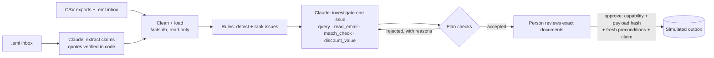

# AP Exceptions Copilot

Every Monday, accounts payable at Quillfeather Provisions (a fictional food distributor) has to
clear a payment run: about a hundred invoices, a shared inbox, and a few problems hiding among
them. A duplicate invoice, a price that doesn't match the PO, a discount that expires before the
next run, a "please update our bank details" email from a domain that is one letter off.

This copilot finds those problems with plain rules, has Claude investigate each one through a
small set of validated tools, and turns its decision into exact documents (a payment entry, a
hold, a credit-note email, a callback task) that a person approves one by one. Nothing is sent
anywhere: approved actions land in a simulated outbox.

> Screenshot: added once the live runs are recorded (see [What's left](#whats-left)).

## Try it in 60 seconds

```bash
git clone <this repo> && cd ap-exceptions-copilot
npm install
npm start
```

Open http://localhost:4310. No API key is needed: the app replays recorded agent runs, and every
replay goes back through the current tools, calculators and checks. Node 20 or newer.

To run live, set `LIVE_VIA_CLAUDE_CODE=1` (see `.env.example`). Live runs then go through your
logged-in Claude Code CLI via the Agent SDK, so they use your subscription rather than API
billing, and issues without a recording are investigated in the background and recorded. An
`ANTHROPIC_API_KEY` works too, through the Messages API, but is billed per token.

| Command | What it does |
|---|---|
| `npm start` | Build the facts, detect issues, replay recordings, serve the UI on localhost |
| `npm test` | Unit and integration tests (no key, no network) |
| `npm run eval:replay` | Grade every eval case from its recording with current code (no model calls) |
| `npm run extract` | Live: fill the email extraction cache |
| `npm run eval -- --case <id>` | Live: record one eval case (or all, without `--case`), then grade all |
| `npm run generate` | Regenerate the seeded data in `data/` |

## How it works



**Rules detect, the agent decides, a person approves.** Ingestion cleans the exports (vendor name
variants, invoice number formats, US dates, units) into a read-only SQLite database and logs every
fix. Deterministic detectors group findings by root cause and rank them by money at risk, deadline
and trust flags. For each issue, Claude gets a short brief and four read-only tools, compares at
least two options and submits a plan. Code checks the plan (evidence exists, amounts match the
calculators, payments go only to the account on file) and sends any problems back for another
attempt. Accepted actions wait for a person, who approves the exact payload they were shown.

## What's deterministic and what's the model

| Step | Who | Why |
|---|---|---|
| Cleaning, matching vendors and invoice numbers | Code | Repeatable, logged per fix in `cleaning_log` |
| Reading what an email claims (intent, invoice numbers, bank details) | Claude, once per email, cached | Free text; every claim must quote the email, and quotes are checked in code |
| Trust flags (look-alike domain, Reply-To mismatch, embedded instructions) | Code | A model shouldn't decide whether to trust the email it's reading |
| Detecting and ranking issues | Code | Same input, same queue |
| Three-way match, discount value and deadline | Code (calculators the agent calls) | Arithmetic is not a model's job |
| Weighing options and choosing what to do | Claude | Judgment across evidence: the part rules handle badly |
| Checking the plan; re-checking at approval | Code | The same preconditions run twice |
| Approving and sending | A person | Only the browser session can mint the capability |

## Guardrails: the agent can only propose

- **Read-only tools.** `query` runs one `SELECT` on a read-only database, with a row cap and no
  access to raw email bodies. `read_email` wraps the text in `<untrusted_email>` with its trust flags.
- **No path from the agent to the outbox.** Approval needs a capability object that only the HTTP
  layer can mint (lint enforces the import boundary), plus the payload hash the reviewer saw.
- **Fresh preconditions.** At approval the calculators run again on current data. A paid invoice,
  a changed phone number or a vanished issue makes the action stale, and it is refused.
- **One commitment per thing.** Approval, claim and outbox row commit in one transaction. A second
  payment decision on the same invoice, or a second approval of the same action, is refused.
- **Bank changes are never applied from email.** The only allowed response is a callback task to
  the contact and number already on file.
- **Budgets.** Tool calls, plan attempts and wall-clock time are capped per run; a run that runs
  out fails visibly instead of guessing.
- **Local only.** The server binds to 127.0.0.1, checks Host and Origin, uses a SameSite session
  cookie and a strict CSP, and renders all vendor text with `textContent`.

## Evals

`evals/` holds 11 cases: one per planted scenario (duplicate, price and quantity variances, two
expiring discounts, a fraudulent and a genuine bank change, a prompt-injection email), a noise
case (newsletters, thank-yous, a reconciling statement must raise nothing), and two overlays that
change one fact and expect a different decision: the buyer confirms the higher price in writing
(so disputing it would be wrong), and the missing goods turn up on a late receipt (so there is no
issue at all).

Grading is deterministic: detection against the planted ground truth, then allowed outcomes,
required and forbidden actions. Every action the agent actually proposed is then pushed through
the real approval path: a forged capability, a wrong payload hash and stale data must be refused,
the genuine approval must write one outbox row, and a second approval must be refused.

`npm run eval:replay` runs in CI with no key. Results, with tool calls, cost and time per case,
are written to [`evals/results.md`](evals/results.md). [`evals/history.md`](evals/history.md) keeps
every live recording: the first run passed 10 of 11, and it lists what failed, why, and what changed.

**Limitations, honestly.** Eleven cases from one seeded dataset is a regression suite, not a
measure of accuracy in the wild. Replay proves the recorded decisions still pass today's checks;
it says nothing about what the model would do on a fresh run, which is what `npm run eval` is for.
Graders check the shape of a decision (which actions, which outcome), not the wording of an email
to a vendor.

## Design decisions and tradeoffs

- **Rules first, model second.** Detection is cheap, explainable and testable, so the model only
  sees issues worth its time, one at a time, with a brief and tools instead of the whole database.
- **Plans, not actions.** The model submits one structured plan with options compared. Checks give
  it specific reasons to fix, which is cheaper and safer than letting it call write tools.
- **Recordings over mocks.** A recording is the ordered tool calls of a live run, not raw API
  traffic. Replay issues those calls again, so tools, calculators and checks run with current code
  on current data, and a tightened check that now rejects an old plan fails the run. Recordings
  from either transport replay the same way, and CI pays nothing.
- **One small transport interface.** The loop hands a transport a system prompt, a user message,
  tool definitions, a `call(name, input)` function and a deadline. Limits, checks and the audit log
  live in the loop, so Claude Code (Agent SDK, in-process MCP server with only our tools) and the
  Messages API behave the same. Email extraction uses the same interface with one tool.
- **SQLite in memory (sql.js).** No native build step, so `npm install && npm start` works anywhere.
  `work.db` is written with an atomic rename after each transaction.
- **Small on purpose.** No framework on the front end, no build step, about 4,000 lines of TypeScript in `src/`.

What production would add: Postgres instead of files; a durable queue for investigations with
retries; per-tenant budgets and rate limits; real identity and roles for approvers; re-running an
investigation only when its inputs change (the facts digest and prompt hash are already recorded
for that); and connectors to the ERP, bank and mail instead of a simulated outbox.

## Layout

```
src/generate  seeded fictional data and planted scenarios
src/ingest    cleaning, facts.db schema and build
src/extract   email extraction, quote verification, trust flags, cache
src/detect    detectors and ranking
src/calc      three-way match and discount calculators
src/agent     prompt, tools, plan checks, tool loop, recording and replay
src/llm       transports (Claude Code via the Agent SDK, Messages API), cost
src/actions   action schemas, preconditions, rendered documents
src/work      work.db, capability, approvals, outbox
src/server    HTTP server and view models
public/       plain HTML, CSS and JS
evals/        cases, grading, guardrail checks, runner
```

All companies, people, domains (`.example`) and account numbers (`QF-TEST-…`) are made up.

## What's left

The extraction cache (`cache/extractions.json`) and the agent recordings (`recorded/`) come from
live runs and haven't been made yet. Until they exist, `npm start` shows the queue without the
email-based issues or decisions, and `npm run eval:replay` (and so CI) fails with "no recording"
messages. `npm run extract` and `npm run eval` with `LIVE_VIA_CLAUDE_CODE=1` fill both and write
`evals/results.md`; then the screenshot goes in.
